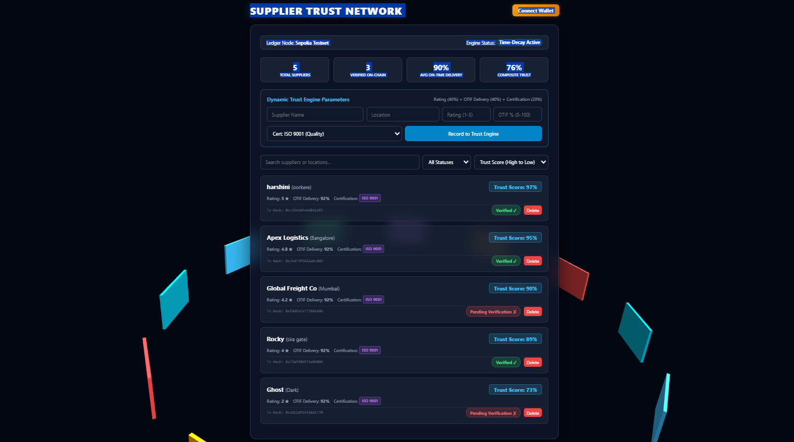

# 🧵 Supplier Trust Network
**Decentralized Supply Chain Verification & Dynamic Trust Scoring Engine**



Supplier Trust Network is a full-stack supply chain management system engineered to track, evaluate, and visualize supplier authenticity for raw material networks. It combines dynamic trust scoring with interactive 3D topology visualization to identify high-risk nodes and ensure transparency across the supply chain.

## 🚀 Key Features & Engineering Highlights

*   **Interactive 3D Supply Chain Graph:** Implements Three.js/WebGL to render global supplier nodes, shipping paths, and risk tiers interactively in 3D space.
*   **Dynamic Trust Scoring Engine:** Calculates real-time, multi-factor reliability scores using historical transaction metrics, quality audit logs, and delivery timestamps.
*   **Relational Storage Layer:** Integrated with SQLite for fast, lightweight transaction processing and supplier metadata management.
*   **RESTful API Architecture:** Express.js backend designed for modular routing, supplier registration, verification logs, and score recalculation endpoints.

## 💻 Tech Stack

*   **Backend:** Node.js, Express.js, SQLite
*   **Frontend Engine:** Three.js (WebGL), HTML5, CSS3, JavaScript (ES6+)
*   **Domain Focus:** Supply Chain Transparency & Web3 Trust Protocol

## ⚙️ Local Setup & Installation

1. Clone the repository:
   ```bash
   git clone [https://github.com/DARSHAN-byte77/supplier-trust-network.git](https://github.com/DARSHAN-byte77/supplier-trust-network.git)